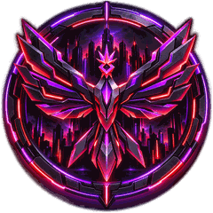

# Nightfall City Ultra for Windows

Nightfall City Ultra is the high-end edition of [Nightfall City](https://nightfallcity.cpengine.store), rebuilt in
Unreal Engine 5 for gaming PCs. This repository holds its Windows downloads (Stable releases only).

**You need a Nightfall City Ultra activation key to play.** Keys come with an Ultra order from the
[Nightfall City store](https://nightfallcity.cpengine.store/ultra). Ultra is not on sale yet: the store page has the
news. A Nightfall City key does not unlock Ultra, and an Ultra key does not unlock Nightfall City.

## What you need

- Windows 10 or 11, 64-bit.
- A gaming PC: a dedicated graphics card, 16 GB of memory or more and an SSD are recommended. On a laptop or everyday
  PC, Nightfall City (the light edition) is the better fit.
- About 1 GB of disk space for the game, and about three times the download's size free while an update installs.
- An internet connection to install and to receive updates. The game itself runs on your PC.

## Install

1. Open the [latest release](https://github.com/taevinbellamy88/nightfall-ultra-releases/releases/latest) and
   download **Install-NightfallCityUltra.cmd**.
2. Double-click it. Ultra isn't code-signed yet, so Windows may warn you: choose **More info**, then **Run anyway**.
   If you're unsure, don't bypass the warning; [contact us](https://nightfallcity.cpengine.store/contact) first.
3. It downloads the game, checks it against the release's SHA-256 checksums, installs it for your Windows user (in
   `%LOCALAPPDATA%\NightfallCityUltra`) and adds **Nightfall City Ultra** to the desktop and the Start menu.
4. Paste your activation key when it asks. The key is in your Nightfall City Ultra order email and starts with `TC1.`.

Prefer a zip? Download `NightfallCityUltra-<version>-win64.zip` from the release, extract it and double-click
`Nightfall City Ultra.cmd` in it: that installs it the same way.

## Your activation key

- It is checked on your PC and never sent anywhere. It is saved in `%LOCALAPPDATA%\TradingCity-Ultra\license.txt`.
- To enter or replace it, open **Nightfall City Ultra activation key** in the Start menu (releases after 0.9.0). On
  0.9.0, delete that `license.txt` and start Ultra: it asks for the key again.
- Keep your order email: it is your proof of purchase for support and refunds.
- Never paste your key into a chat, a forum post, a screenshot or a GitHub issue.

## Updates

Every time you start Ultra from its shortcut, it checks this repository for a newer Stable release. A newer one is
downloaded, checked against its SHA-256 checksums and installed before the game starts; the version before it is kept.
Offline, or if anything goes wrong, it starts the version you have. Your city, agents and settings
(`%LOCALAPPDATA%\TradingCity-Ultra`) are never touched by an update.

## What leaves your PC

- The launcher asks GitHub for the latest release at each start, and downloads updates from GitHub.
- The game talks only to its own agent service on your PC (`127.0.0.1`). The agent service is the one Nightfall City
  uses; it connects to the online services you set up in it, such as an AI provider. See the store's
  [privacy policy](https://nightfallcity.cpengine.store/privacy).

## Uninstall

There is no uninstaller yet. To remove Ultra:

1. Close it, then delete the `%LOCALAPPDATA%\NightfallCityUltra` folder.
2. Delete the **Nightfall City Ultra** shortcuts from the desktop and the Start menu.
3. Only if you also want to delete your Ultra city, agents, settings and activation key: delete
   `%LOCALAPPDATA%\TradingCity-Ultra`.

## Check a download yourself

Each release lists a `.sha256` file. In PowerShell: `Get-FileHash .\NightfallCityUltra-<version>-win64.zip` and
compare the hash with the one listed for that file.

## Help

[Contact us](https://nightfallcity.cpengine.store/contact) ·
[Refund policy](https://nightfallcity.cpengine.store/refund) ·
[Terms](https://nightfallcity.cpengine.store/terms) ·
[EULA](https://nightfallcity.cpengine.store/eula) ·
[Privacy](https://nightfallcity.cpengine.store/privacy)

Nightfall City is a product of ClearPath AI, a brand of ClearPath Innovative Solutions LLC.
